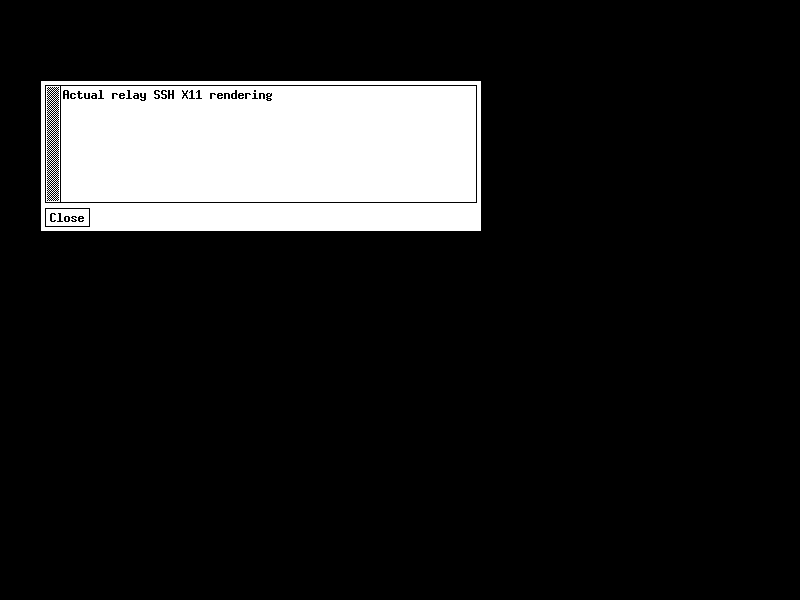

# 会话复制、Telnet 与 X11（1.6.0）

发行状态以 GitHub v1.6.0 Release 为准，需要 Aide v0.1.18.0-RC2+；市场最低版本为0.1.18.0 RC2，不提供sourceCompatibility降级。归档位于packages/v1.6.0/，不能以旧1.5.3包作为新功能证据。配套 Aide 提供可信的 `sessionCopyVersion: 1` 上下文；旧宿主复制入口禁用并提示升级。手动导入ZIP绕过市场版本检查，应先升级宿主。相关需求与缺陷：[726](https://github.com/skyelan1999/aide/issues/726)、[728](https://github.com/skyelan1999/aide/issues/728)、[730](https://github.com/skyelan1999/aide/issues/730)。

## 使用复制

选中会话，点击「复制会话」。可选「仅复制设置」或「复制并连接」。新会话有独立 ID、状态、终端进程/连接、输出缓冲及日志；不会重放历史命令或复制原终端内存、已执行的 cd/export、认证密码、私钥口令及历史输出。复制的是保存的起始目录、连接参数、尺寸、日志及可见性设置。隐藏会话仍保持隐藏，模型不能通过伪造工作台参数访问它。

本地 Shell、工作区 SSH、独立 SSH、Telnet、TCP 客户端可新建并存连接。工作区 SSH 复用宿主管理的规范 SSH master，但每个副本有独立 PTY/SSH channel；关闭一个不会关闭 master 或其他副本。独立 SSH 则重新认证并保留原有主机指纹校验。串口及固定 TCP 监听只允许复制设置，避免自动抢占独占资源；被动接入的 TCP peer 不能复制。UDP 副本使用新的自动分配本地接收端口，远端目标不变。

工作区 SSH 如需 X11，可选「新建独立 SSH 连接」：仅预填公开主机、端口和用户名，用户重新选择认证方式；不会复制工作区 master、密码或其隐藏凭据。

### 复用一个中继

复制中继会话时，复用同一已部署中继的身份、密钥与固定目标，每个副本建立独立认证 TLS 流和本地会话/日志，无需再部署脚本。中继目标仍由原部署脚本确定，不能靠修改复制参数改变远端目标。SSH/Telnet/TCP 可并存至既有中继连接上限（8）；串口仍不能同时占用。关闭或删除一条本地会话不停止远端 agent，也不撤销共享密钥；远端重置中继身份/密钥会影响所有副本。脚本和私有密钥文件须按凭据保管。

## Telnet

新建时选择 Telnet，填目标主机/端口（通常 23），可直接连接或勾选「通过中继部署」。终端处理 IAC 协商与转义、NVT CR-NUL/CR-LF、SGA/ECHO、TTYPE、NAWS 窗口尺寸及 BINARY 协商；同一解析器适用于 TCP 和 TLS 中继流。分片的 IAC/子协商、255 尺寸转义及跨 16 KiB 输入片段的 CRLF 有回归测试。界面以 UTF-8 显示/输入；未提供旧设备 GBK/Big5 编码转换。二进制/hex 输入保留字节语义，不做文本换行处理。不是所有 Telnet RFC 选项都实现。

默认不做本地回显，避免把未回显的密码自行写到输出或日志。只有明确勾选本地回显且对方未启用 ECHO 时才回显；认证时应保持关闭。设备自身回显仍可能记录在输出日志。不会自动发送用户名/密码、自动重连或重发不确定输入。

Telnet 使用 `terminal_tcp_connect` 连接禁用策略；连接后禁用 `terminal_tcp_send` 会阻止下一次应用输入，包括中继会话。固定 IAC 应答与已有连接的窗口控制属于协议控制帧，仍可发送；调整尺寸另受既有 session_resize 工具入口约束。中继 TLS 只保护 Aide 到中继这一段；中继到 Telnet 设备仍使用 Telnet 原协议，通常无加密。

## SSH X11

仅独立 SSH 设备会话及其 SSH-over-relay 支持显式 X11。采用 OpenSSH 非信任模式 `-X`、`ForwardX11Trusted=no`、20 分钟新连接超时；保留 SSH 主机校验，不自动切换到 `-Y`。工作区 master 复用终端不修改 master 的转发设置。服务端拒绝转发、非信任扩展不兼容等错误仍按 SSH 输出显示；「X11 已请求」不代表窗口已显示。

前提：

1. 用户已有运行中的真实 X Server，且 Aide 运行环境可以到达其 DISPLAY；不自动安装 XQuartz、不自动开放监听或修改防火墙。
2. Aide 运行环境有可执行的 `xauth`，并有对应 DISPLAY 的有效 MIT-MAGIC-COOKIE-1 Xauthority 条目。预检缺失时明确拒绝，不退回无认证。cookie 只在进程内验证，不返回网页/模型或写日志。
3. 远端 SSH 服务允许 X11Forwarding，且远端安装 xauth。插件不修改远端 sshd 配置。

新源码 Dockerfile 的 runtime 声明 xauth；旧镜像、Dockerfile.local 使用的保留依赖镜像、dev/native 自定义环境不因此自动获得它，须由部署方准备依赖或重建配套镜像。运行时缺失会报错，不影响未启用 X11 的其他终端。

### Docker 中提供 DISPLAY 与 Xauthority

容器中的 `localhost` 是容器自身。以已有且已经配置认证访问的宿主 X Server 为例，Docker Desktop 可使用 `host.docker.internal:0.0`，前提是该 X Server 本来就监听对应可达端点并允许有效 cookie；不是要求自动开放 TCP 监听。Linux 的 Unix DISPLAY 需由用户事先映射 X socket 与对应认证文件。实际 DISPLAY、网络与 cookie 必须匹配。

两条可操作路径：

- 工作区文件路径：将已有 X Server 认证文件的私有副本放到当前工作区 `private-x11/Xauthority`，先将整个目录加入本机 Git exclude/项目忽略规则，并仅允许 Aide 运行用户读取。创建会话时填写可达 DISPLAY 和相对文件 `private-x11/Xauthority`。宿主共享目录权限须确保容器正常运行用户可读；不要把 cookie 文件提交 Git、粘贴到聊天或输出到日志。
- 只读容器挂载：使用用户自己的 Compose override 将既有认证文件只读挂载到 `/run/aide-x11/Xauthority`，给 Aide 服务设置 `DISPLAY` 和 `XAUTHORITY`；创建会话时 DISPLAY 可留空沿用环境，认证文件字段留空。部署时自行替换下面绝对路径，确认容器用户可读。此操作需用户按自己的部署流程重建/重启，不由插件自动执行。

```yaml
services:
  aide:
    environment:
      DISPLAY: host.docker.internal:0.0
      XAUTHORITY: /run/aide-x11/Xauthority
    volumes:
      - type: bind
        source: /absolute/private/path/Xauthority
        target: /run/aide-x11/Xauthority
        read_only: true
```

不要使用 `xhost +`、关闭 X Server 认证、把 cookie 输出给模型或为此暴露未经认证的局域网端口。已有会话认证已成立后，远端可运行用户已安装的 X 客户端验证窗口；插件不安装远端 GUI 应用。

## 验证与边界

验证入口：

- `npm test`：源运行时 56 项，无跳过；覆盖真实 Linux PTY、OpenSSH、TCP/UDP、虚拟串口、背压及上述新协议/隔离回归。
- `python3 scripts/package.py --release` + `python3 scripts/verify_package.py packages/v1.6.0/aide-pkg-terminal-v1.6.0.zip`：解包实际候选运行，不借用源码模块/宿主 node_modules。
- `node test/browser-session-features.cjs`：真实 Chromium 与 Sessions 后端、loopback Telnet，1440/390px、明暗两套界面。剪贴板测试为合成 ClipboardEvent，不读取系统剪贴板。
- 配套 Aide：`AIDE_TERMINAL_FEATURE_BUNDLE_PATH=<候选绝对路径> go test ./internal/server -run TestTerminalSessionFeaturesInstalledCandidate`，将实际 ZIP 安装到隔离 App/daemon，验证复制、隐藏授权、真实 Telnet 与动态禁用发送。
- `test/x11.test.js`：真实 OpenSSH 直连/中继，合成 xauth helper、合成 X11 endpoint 验证通路与认证字节，不能作为真实 X Server 窗口显示验收。
- `test/ssh-auth.test.js`：真实 workspace SSH master 和长私有路径，验证规范短 socket 与原 master inode/身份一致；不同 inode/软链接拒绝，不靠用户旗标放宽。

真实 Linux Xvfb + xauth + OpenSSH + xmessage 的直连与 TLS relay 窗口显示已通过；见下节强验证。真实 macOS XQuartz、用户设备 Telnet、硬件串口及 Windows 原生功能：NOT_RUN。宿主正式 runtime 镜像的 xauth 依赖由 Aide RC2 主程序发行门禁单独验收，不能以插件 QA 镜像替代。跨平台真实运行仍须按发行门禁验收。

## 回滚与兼容

打包命令不自动发布/修改市场；安装前备份 Aide 私有终端数据，插件重载会断开连接，不重放输入。退回旧插件后 Telnet 新类型不会被旧版本加载，但不应删除私有记录/日志/共享中继密钥；原有支持的会话仍可使用。配套宿主只新增规范上下文字段与 runtime 依赖，旧插件继续忽略新字段。不要同时启动两个实例写同一私有状态目录。

## 真实 X11 窗口强验证

`scripts/test-x11-live.py` 只允许显式开启的 Docker 隔离环境，以正常 UID1000 运行插件客户端，启动真实 cookie 认证的 Xvfb、真实xauth、仅loopback监听的OpenSSH服务，以及实际xmessage客户端。Xvfb仅Unix socket，不使用xhost+；SSH StrictModes与主机指纹确认保留。用户提供的Xauthority副本0400且内容/inode保持不变。直连显示窗口，中继副本关闭源连接后仍可显示窗口，保存xwd/PNG、xwininfo窗口树和JSON记录。

CI额外构建测试专用Dockerfile.x11，以network=none执行正式ZIP解包运行时，再运行真实窗口测试。QA镜像不会替代Aide服务，不安装宿主XQuartz、不改系统授权或外部监听。这是Linux虚拟X Server实际渲染，不能等同于macOS XQuartz或真实用户设备验收。


