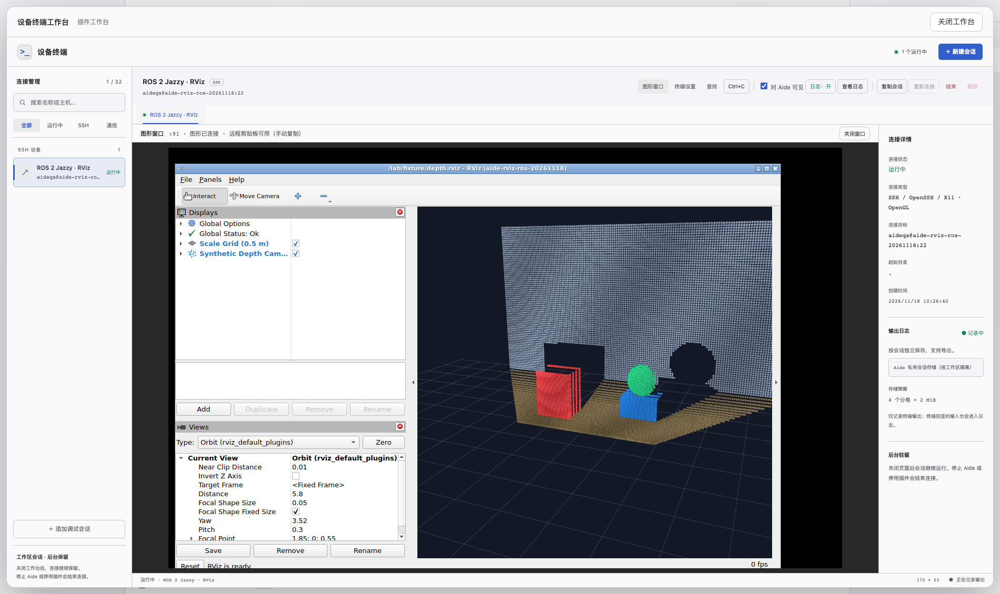

# Terminal 1.8.3 · RViz 实机验收

[Aide #946](https://github.com/skyelan1999/aide/issues/946)

2026-11-18 在隔离 Aide 和 Ubuntu 24.04 ARM64 Docker 环境验证。远端运行 ROS 2 Jazzy，使用回放夹具发布每帧 144 × 108 的彩色深度点云。验收覆盖 Terminal 直连 SSH 与 Aide 工作台中的 noVNC 图形窗口。

## 归档与升级

- `packages/v1.8.3/aide-pkg-terminal-v1.8.3.zip`，1,235,979 bytes，SHA-256 `3cca9d1054a3c8857d052e4d16beb6f033647145c11b974f21428adcff226e52`。
- 隔离 Aide 从公开的 Terminal 1.8.2 使用本地 ZIP 升级到该 1.8.3 归档。宿主实例标识与完整性检查一致，插件启用状态和配置一致，标准升级备份可用。原 SSH 会话 ID 保留，升级前的终端日志字节一致。
- 市场最低版本保持 Aide `0.1.18.0 RC3`，与现有 Terminal 基础功能兼容。图形窗口使用包含 viewer 代理、Xvfb、xauth、x11vnc 和 websockify 的 Aide Linux 运行时。本次使用带该运行时的 Aide `0.1.19.0 RC2`。

## 浏览器结果

- 已保存的 SSH 会话保留「自动启用图形窗口」。重连后 无需配置 DISPLAY、Xauthority 或 OpenGL 环境变量，Aide 自动打开图形窗口。
- 新建 SSH 的同一个开关默认开启。输入主机、用户名和认证信息后，Terminal 自动打开图形窗口。远端 `glxinfo -B` 报告 Mesa OpenGL core profile 4.5。
- 从 Terminal SSH 同时启动 `ros2 bag play --loop --disable-keyboard-controls` 和普通的 `rviz2 -d`。RViz 报告 OpenGL 4.5，订阅 `/synthetic/depth/points`。回放在 1 倍速时测得 5.933–6.060 Hz，浏览器画面的红色物体在两次采样间横向移动 24.38 px，工作台脚本错误为零。
- 实际直连使用通过指纹检查的 OpenSSH `-Y` 和会话专用的 Unix-only Xvfb。Xauthority 文件为 0600，父目录为 0700。继续使用 Xvfb 原有配置，Ubuntu 容器只有 RViz 和 rosbag 进程参与渲染及回放。新的 SSH 会话自然结束后，其显示已释放，另一个会话保持连接。
- 直连以外的路径继续使用 `-X`。中继及外部 DISPLAY 的协议回归由 Linux 套件覆盖。1.8.2 基线可显示普通 X11 应用，直接 RViz 的 GLX 初始化失败。
- Linux ARM64 源码套件 79/79 通过。仅从版本归档提取运行时及生产依赖后独立执行 74/74，全部通过。

